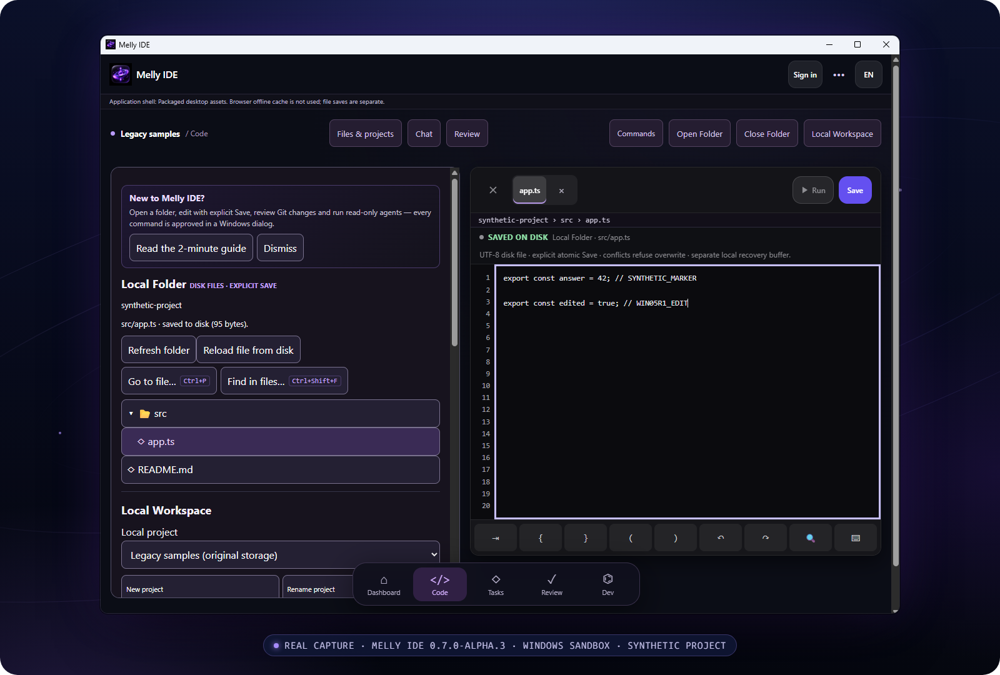
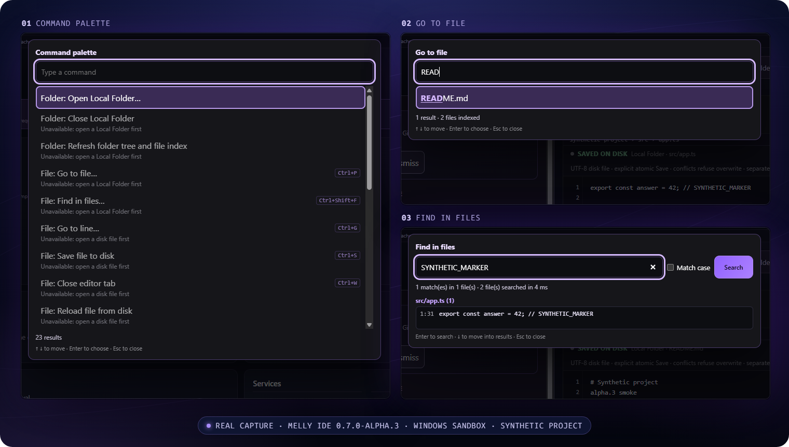
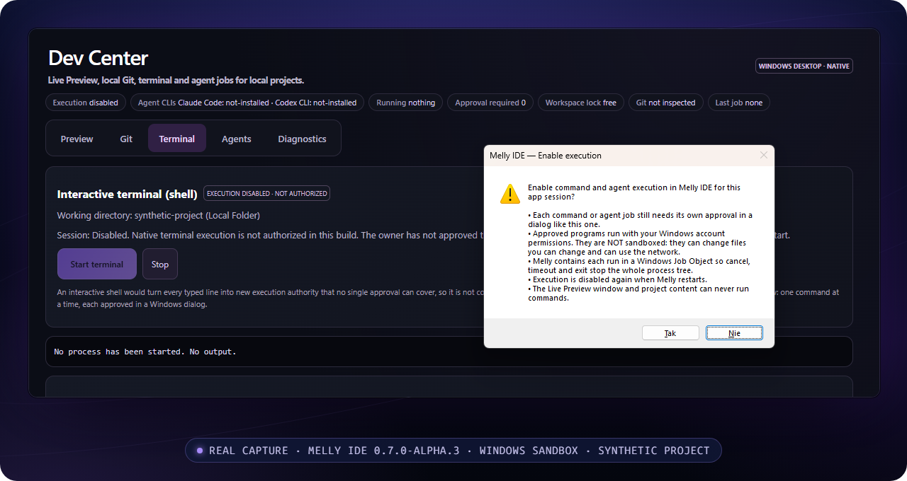
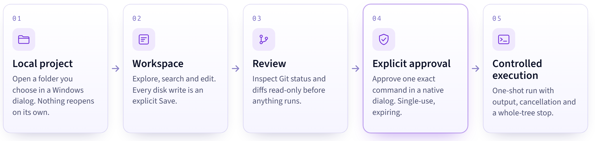

<div align="center">

<picture>
  <source media="(prefers-color-scheme: dark)" srcset="docs/assets/readme/melly-ide-wordmark-dark.png">
  
</picture>

### Your workspace. Your agents. Your control.

A local-first coding workspace for Windows. Open a real folder, edit deliberately, review Git changes without touching them, and let commands and agents run only after you approve each one.

[](#roadmap) [](#get-started) [](#architecture) [](#license-and-brand)

**[Build from source →](#get-started)** &nbsp;·&nbsp; [Explore features](#features) &nbsp;·&nbsp; [Security model](docs/product/SECURITY-MODEL.md) &nbsp;·&nbsp; [Roadmap](#roadmap)

<sub>Version 0.7.0-alpha.3 · Windows 11 x64 · Unsigned experimental build · No installer has been published yet</sub>

</div>

<br>

<p align="center">
  
</p>

<p align="center"><sub>A real capture of the 0.7.0-alpha.3 Windows executable during its Windows Sandbox acceptance run, using a synthetic project. The frame is cropped to the app window, and nothing inside it was edited.</sub></p>

## See it in action

Every screenshot on this page comes from the same 0.7.0-alpha.3 executable and Sandbox session. The background and caption around each frame are a presentation layer; the app pixels are unchanged.

<p align="center">
  
</p>

**Fast navigation.** The command palette, Go to File and literal Find in Files keep you on the keyboard. In the palette capture, folder and file commands are marked unavailable because no folder was open yet. They unlock when you open one.

<p align="center">
  
</p>

**Controlled execution.** Turning on execution takes a native Windows dialog, and every command or agent job still needs its own approval. The interactive terminal stays disabled in this build. The Sandbox used a Polish system locale, so the dialog buttons read *Tak* (Yes) and *Nie* (No).

> [!NOTE]
> The alpha.3 Sandbox session did not open a Git repository or run an agent job, so this page shows no screenshot of the read-only Git view or the Agent Control Center. Older captures exist from an earlier build. They are not shown here, so they cannot be mistaken for 0.7.0-alpha.3.

## Why Melly IDE

<table>
<tr>
<td width="50%" valign="top">
<br>
<b>Local-first by default</b><br>
Your code stays on your disk. You choose a folder in a Windows dialog, nothing syncs to a cloud, and a restart never reopens a folder on its own.
</td>
<td width="50%" valign="top">
<br>
<b>Deliberate editing and recovery</b><br>
Every write is an explicit Save. A Save that would overwrite a file changed elsewhere is refused, and unsaved work goes to separate local recovery buffers.
</td>
</tr>
<tr>
<td width="50%" valign="top">
<br>
<b>Git visibility without side effects</b><br>
See status, change totals, hunks and side-by-side diffs. Melly reads repository data itself. It never runs Git, hooks, staging, commits or pushes.
</td>
<td width="50%" valign="top">
<br>
<b>Guarded agent workflows</b><br>
Claude Code and Codex CLI are detected and orchestrated through read-only profiles, and you approve each run in a native dialog. Writable profiles stay locked.
</td>
</tr>
</table>

## How it works

<picture>
  <source media="(prefers-color-scheme: dark)" srcset="docs/assets/readme/how-it-works-dark.png">
  
</picture>

An approval covers one exact program, argument list, folder and profile. It is single-use and expires. Restarting the app disables execution again and never reruns an interrupted job. Agent jobs take the same path with read-only profiles. Approving an agent job covers that whole agent session, not each later tool action, and a read-only profile does not guarantee that reads stay inside the workspace. Claude `edit` and Codex `workspace-write` stay blocked with `PROFILE_GATED` until an owner-approved security contract exists.

## Features

### Available now

| Capability | What you get | Boundary |
|---|---|---|
| Windows desktop app | Tauri 2 shell, WebView2 frontend, Rust native commands | Windows 11 x64 only |
| Files and editing | Folder Explorer, editor tabs, explicit Save, conflict refusal | One folder per session; existing UTF-8 files up to 1 MiB |
| Navigation | Command palette, Go to File, literal Find in Files, Go to Line | Bounded native index; `.git` and generated folders skipped |
| Read-only Git | Status, change totals, hunks, side-by-side diff | No Git executable, hooks, staging, commits or pushes |
| Recovery | Disk recovery buffers, browser-local projects, backup v3 | Plaintext in your local profile; manual transfer only |
| Approved command runner | One program plus an argument list per approval, with output and cancellation | Off at every start. Not an interactive terminal |

### Limited or experimental

| Capability | Current state |
|---|---|
| Agent Control Center | Detects Claude Code and Codex CLI, probes versions and queues read-only jobs. No real paid-provider task has been accepted yet |
| Live preview | Runs in a separate window with no app capabilities. Network isolation is not fully evidenced |
| Windows installer | Unsigned per-user NSIS build. Passed a Windows Sandbox smoke test in an administrator context. Not published. If WebView2 is missing, it downloads Microsoft's WebView2 bootstrapper, which needs Internet access |
| Browser developer view | `npm start` renders the frontend without native folders, Git or execution |
| MCP, automations, legacy chat | Include simulated or disconnected surfaces |

### Planned, not available

- **Writable agent profiles** need a reviewed security contract first.
- **Interactive terminal** (PTY/ConPTY). The runner is deliberately one-shot.
- **Cloud source sync** across devices or accounts.
- **Hosted AI and paid plans.** No paid inference or Pro billing is active.
- **macOS, Linux and iOS builds.** Windows is the only verified target.

The [feature inventory](docs/product/FEATURES.md) maps each capability to its code, tests and acceptance status.

## Get started

> [!IMPORTANT]
> **No installer is published.** A 0.7.0-alpha.3 Windows installer exists only as an unsigned local build. If one is published later, it will appear on this repository's Releases page with SHA-256 hashes. Until then, run Melly IDE from source.

**Requirements**

| | |
|---|---|
| Operating system | Windows 11 x64 |
| Runtime | Microsoft Edge WebView2 (included with Windows 11) |
| Browser developer view | Node.js 24.15.0 or newer |
| Native Windows app | Rust (MSVC toolchain), Windows C++ Build Tools and SDK |

**Browser developer view.** Run this from the repository root in PowerShell, then open `http://127.0.0.1:3000`.

```powershell
npm ci --ignore-scripts
npm start
```

**Native Windows app.** Run this from an x64 MSVC developer shell. Use a disposable profile and a synthetic folder for testing.

```powershell
npm run desktop:prepare
cargo run --locked --target x86_64-pc-windows-msvc --manifest-path src-tauri/Cargo.toml
```

**Validate your checkout.**

```powershell
npm test
npm run typecheck
```

Read [Getting started on Windows](docs/product/GETTING-STARTED-WINDOWS.md) for every command, and the [development guide](docs/DEVELOPMENT.md) for Rust and Chromium checks.

**Where alpha.3 stands.** In an isolated, offline Windows Sandbox, the 0.7.0-alpha.3 executable passed 19 of 20 native scenarios. One scenario, in-app file creation, was not run because Local Folder saves existing files only. The NSIS installer installed, reinstalled and uninstalled cleanly in an administrator context. Standard-user installation, Defender, UAC, SmartScreen and Mark-of-the-Web checks are still open, and the build is not code-signed.

## Architecture

<picture>
  <source media="(prefers-color-scheme: dark)" srcset="docs/assets/readme/architecture-dark.png">
  
</picture>

The Rust approval broker owns execution authority. Nothing in the frontend can approve a run for you. **Approved commands run with your Windows permissions. Windows Job Objects manage process lifetime, but they are not an OS sandbox.** The default build does not activate Convex, Cortex, cloud identity or paid AI. Each needs its own activation and acceptance. Read the [security model](docs/product/SECURITY-MODEL.md) and the [product architecture](docs/product/ARCHITECTURE.md), which keeps an editable Mermaid version of this diagram. No security certification is claimed.

## Roadmap

| Now: in 0.7.0-alpha.3 | Next: acceptance in progress | Later: separately planned |
|---|---|---|
| Windows shell, folder editing and recovery | Real read-only agent tasks against a paid provider | Writable agent profiles, after a security contract and independent review |
| Palette, Go to File, Find in Files | Standard-user, Defender, SmartScreen and code-signing checks for the installer | Interactive terminal |
| Read-only Git review | QA follow-ups: preview IPC timeouts, high-DPI and assistive technology | Public distribution and account-private source sync |
| Approved one-shot runner and read-only agent orchestration | Owner review of daily workflows | Supported macOS and Linux builds |

No date is a delivery commitment. Details: [product roadmap](docs/product/ROADMAP.md).

## Documentation

| Guide | What it covers |
|---|---|
| [Getting started](docs/product/GETTING-STARTED-WINDOWS.md) | Browser and native developer commands |
| [Features](docs/product/FEATURES.md) | Capability inventory, evidence and acceptance |
| [Architecture](docs/product/ARCHITECTURE.md) | Frontend, native and provider ownership |
| [Security model](docs/product/SECURITY-MODEL.md) | Approvals, external-tool limits, recovery and privacy |
| [FAQ](docs/product/FAQ.md) | Terminal, providers, platforms, licensing and distribution |
| [Media sources](docs/showcase/MEDIA-SOURCES.md) | Where every image on this page comes from |
| [Development guide](docs/DEVELOPMENT.md) | Toolchain and deeper validation |

## Community

- **Contribute.** Read [CONTRIBUTING.md](CONTRIBUTING.md) and [AGENTS.md](AGENTS.md) first. Collaboration is coordinated by the maintainer during the alpha.
- **Report a bug or request a feature.** Use the [bug report](.github/ISSUE_TEMPLATE/bug_report.md) or [feature request](.github/ISSUE_TEMPLATE/feature_request.md) template with synthetic data only.
- **Report a vulnerability privately.** Follow [SECURITY.md](SECURITY.md). Never put exploit details or secrets in a public issue.
- **Share feedback.** Issues are the place for feedback while the alpha is in progress. There is no support commitment.

## License and brand

Melly IDE's own source code and documentation are licensed under the [Apache License 2.0](LICENSE). Copyright 2026 Mateusz Ozimkiewicz (Melly-999) for the original project material he controls.

- **Images, icons, screenshots and recordings** (`.png`, `.gif`, `.svg`, `.ico`) are not covered by Apache-2.0. No license to reuse them is granted.
- **The orbital icon ("Orbit")** is AI-assisted branding. Mateusz Ozimkiewicz created it from his own text descriptions with OpenAI image generation (ChatGPT, `gpt-image`). The master file keeps its C2PA provenance manifest.
- **The Melly IDE name, logo, icons and brand compositions** are not licensed as trademarks (Apache-2.0, Section 6).
- **Third-party material** keeps its own terms. This includes the checked-in Convex code-generation output, npm and Cargo packages, and `@cortexmemory/sdk` (FSL-1.1-Apache-2.0, source-available). Installers carry additional notices that are reviewed before any distribution.

Full scope and exclusions: [Licensing scope](docs/product/LICENSING.md).

<br>

<p align="center">
  <br>
  <sub><b>Melly IDE</b> · Orbit<br>A local-first Windows workspace in experimental alpha.</sub>
</p>
