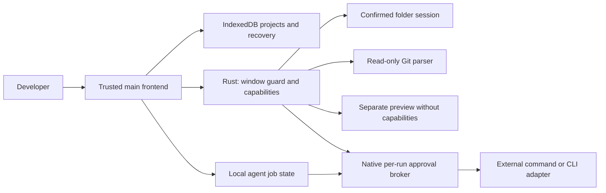

<div align="center">

# Melly IDE

**Your workspace. Your agents. Your control.**

A Windows coding workspace for exploring local files, editing deliberately, reviewing Git changes, and preparing approved agent work.

**Private Alpha · Windows 11 · Tauri 2 / WebView2**

[Start locally](docs/product/GETTING-STARTED-WINDOWS.md) · [Features](docs/product/FEATURES.md) · [Security model](docs/product/SECURITY-MODEL.md) · [Architecture](docs/product/ARCHITECTURE.md)

</div>

## Why Melly IDE?

- **Keep the project in view.** Explorer, editor tabs, a command palette, Go to File and literal Find in Files keep navigation close to the code.
- **Make changes deliberately.** Disk files use explicit Save, version checks that refuse conflicting writes, and separate local recovery buffers. A restart never reopens a folder by itself.
- **Review before acting.** Git status and diffs are read natively without running Git. Commands and agent jobs need a native Windows approval for each run.

This source matches the locally built 0.7.0-alpha.3 Windows app. The app and the development package are both version `0.7.0-alpha.3`.

## See it work

Native screenshots, recordings and brand compositions are withheld from the public source until their media rights are confirmed. [Native capture](docs/showcase/NATIVE-CAPTURE.md) documents how they were made.

## What is available locally?

| Capability | Current implementation | Boundary |
|---|---|---|
| Windows desktop | Tauri 2 shell, WebView2 frontend, Rust native commands | 0.7.0-alpha.3 unsigned EXE and NSIS installer; Windows Sandbox smoke test passed in an administrator context; standard-user, Defender and SmartScreen acceptance pending |
| Files and editing | Folder-scoped Explorer, tabs, explicit Save, conflict checks | Windows folder dialog per session; UTF-8 files up to 1 MiB |
| Navigation | Command palette, Go to File, literal Find in Files, Go to Line | Bounded native index and search; `.git` and generated folders skipped |
| Git review | Native read-only parser, change totals, hunks, side-by-side view | No Git executable, hooks, staging, commits or pushes |
| Command Runner | Approved one-shot executable with an argument array, output, cancellation | Disabled at every start; native approval per run |
| Agent Control Center | Claude Code / Codex CLI detection, probes, job queue, cancellation | Read-only profiles only; writable profiles are `PROFILE_GATED` |
| Workspace and recovery | Browser-local projects, backup v3, disk recovery buffers | Manual transfer; no cloud source sync |

[Full feature inventory](docs/product/FEATURES.md) separates implementation, tests and owner acceptance. MCP, automations and legacy chat include simulated or disconnected surfaces.

## Current limitations

- **Command Runner is one-shot.** It runs one approved executable per request. It is not an interactive terminal, PTY or ConPTY.
- **Writable agent profiles remain gated.** Claude `edit` and Codex `workspace-write` are blocked by `PROFILE_GATED` until an owner-approved security contract exists.
- **Paid provider execution acceptance is pending owner review.** No real Claude Code or Codex task was run for this documentation or its media.
- **Browser mock testing is not native QA.** Browser suites that use a MOCK native bridge prove rendering and interaction only. This README's media comes from the native app.
- **0.7.0-alpha.3 is an unsigned, experimental pre-release build.** The app, installer, reinstall and uninstall worked in an isolated, offline Windows Sandbox (administrator context). Standard-user installation, Defender, UAC and SmartScreen behaviour are not yet tested. Any published copy appears only on the repository's Releases page with its SHA-256 hashes. There is no code signature or support commitment.
- **WebView2 may be downloaded during installation.** If no Microsoft Edge WebView2 Runtime is detected, the installer downloads and runs Microsoft's WebView2 bootstrapper, which needs an Internet connection. Installation is fully offline only when WebView2 is already present (Windows 11 normally includes it).

## Quick start

Use PowerShell from the source root with Node.js **24.15.0 or newer**.

```powershell
npm ci --ignore-scripts
npm start
```

Open `http://127.0.0.1:3000`. Browser mode edits browser-local workspaces; it has no native folder access, Git inspector or execution broker. The Windows app needs Rust/MSVC, the Windows C++ Build Tools/SDK and WebView2. Follow [Getting started on Windows](docs/product/GETTING-STARTED-WINDOWS.md) and the [development guide](docs/DEVELOPMENT.md).

## Agent workflow and permissions

1. Open a disposable folder in the Windows app. Detection locates a CLI; Check CLI runs only its version and help commands.
2. Enable execution for the current session in a native dialog. This approves no run.
3. Review the exact program, arguments, folder, profile and disclosures, then approve that one run in a native dialog. Approval is bound to the specification, expires and is single-use.
4. Review output, process outcome and the Git diff. A zero exit code does not prove the requested work succeeded, and restart never reruns interrupted jobs.

## Security model

Approved commands run with your Windows permissions. **Windows Job Objects manage process lifetime; they are not an OS sandbox.** Approving an agent job covers that whole agent session, not each later tool action, and read-only profiles do not guarantee that reads stay inside the workspace.

The folder broker, isolated preview window and read-only Git parser have narrower contracts, but they do not make external CLIs safe. Local workspace and recovery data is plaintext in the profile. Read the [security model](docs/product/SECURITY-MODEL.md), [MEGA-08](docs/MEGA-08.md), [MEGA-09](docs/MEGA-09.md) and the [reporting policy](SECURITY.md). No security certification is claimed.

## Architecture



[Product architecture](docs/product/ARCHITECTURE.md) maps state owners to modules. Optional cloud identity, AI providers and source synchronization are separate concerns.

## Status and roadmap

**Implemented and locally tested:** editing and navigation, read-only Git review, guarded one-shot execution and agent orchestration infrastructure. The native screenshots and recordings were captured from the MEGA-08.2/09 build; they demonstrate the UI, not a new native QA pass.

**Pending owner acceptance:** real paid read-only agent tasks, the writable-agent security contract, distribution and publication. **Planned or unavailable:** an interactive terminal, writable agent profiles for general use, cloud source sync and supported macOS/Linux/iOS builds. [Roadmap](docs/product/ROADMAP.md).

## Developer documentation

| Guide | Purpose |
|---|---|
| [Getting started](docs/product/GETTING-STARTED-WINDOWS.md) | Browser and Windows developer commands, validation limits |
| [Features](docs/product/FEATURES.md) | Capability inventory, evidence and acceptance status |
| [Architecture](docs/product/ARCHITECTURE.md) | Frontend, native and provider ownership |
| [Security model](docs/product/SECURITY-MODEL.md) | Approvals, external-tool limits, recovery and privacy |
| [FAQ](docs/product/FAQ.md) | Terminal, providers, platforms, licensing and distribution |
| [Native capture](docs/showcase/NATIVE-CAPTURE.md) | Build identity, isolation and capture method for the withheld native media |
| [Media sources](docs/showcase/MEDIA-SOURCES.md) | Media provenance, withheld assets and the synthetic fixtures |
| [Engineering development guide](docs/DEVELOPMENT.md) | Toolchain and deeper validation workflows |

## Contributing and support

Collaboration is owner-coordinated during the private alpha. Read [CONTRIBUTING.md](CONTRIBUTING.md) and [AGENTS.md](AGENTS.md) before proposing changes. No public support commitment exists. Report bugs and feedback with the repository's [bug report](.github/ISSUE_TEMPLATE/bug_report.md) or [feature request](.github/ISSUE_TEMPLATE/feature_request.md) templates, using synthetic data only. For sensitive reports follow [SECURITY.md](SECURITY.md), and confirm a private channel exists before sending details.

## License

Copyright 2026 Mateusz Ozimkiewicz (Melly-999) for the original project material he controls.

Melly IDE's own source code and documentation are licensed under the [Apache License, Version 2.0](LICENSE) (SPDX `Apache-2.0`). Version 0.7.0-alpha.3 is an unsigned pre-release build. Any published copy lists its exact SHA-256 hashes, signing status, third-party notices and source availability on the Releases page. No support commitment exists. Contributions are accepted under the same license, as described in [CONTRIBUTING.md](CONTRIBUTING.md).

- **Third-party material** includes the checked-in Convex code-generation output. npm and Cargo packages are installed separately and keep their own licenses. `@cortexmemory/sdk` uses FSL-1.1-Apache-2.0, a source-available license that restricts competing commercial use.
- **Images, icons, screenshots and recordings** (`.png`, `.gif`, `.svg`, `.ico`) are not covered by Apache-2.0, and no license to reuse them is granted.
- **The orbital icon ("Orbit")** is AI-assisted branding. Mateusz Ozimkiewicz created it from his own text descriptions with OpenAI image generation (ChatGPT, `gpt-image`). The master file keeps its C2PA provenance manifest. See [Licensing scope](docs/product/LICENSING.md#name-and-logo).
- **Files generated by the Convex CLI** under `convex/_generated/` keep the terms of the tool that produced them. Convex's AI guidance is downloaded locally and is not part of the repository.
- **The Melly IDE name, logo, icons and brand compositions** are not licensed as trademarks (Apache-2.0, Section 6).
- **Installers and binaries** carry additional third-party notices. They are reviewed separately before any distribution.

Details, scope and exclusions: [Licensing scope](docs/product/LICENSING.md).
