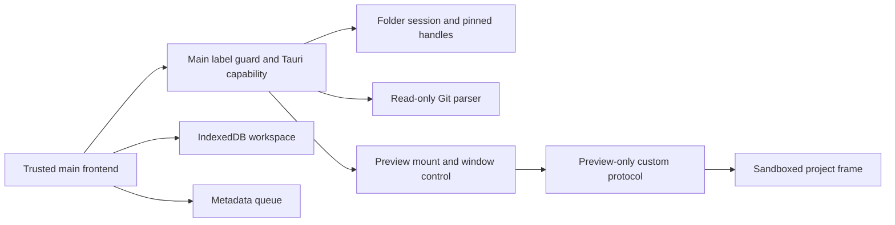

# Architecture

Melly IDE — Midnight uses modular JavaScript presentation over a Rust/Tauri 2 native boundary. Windows WebView2 is the primary runtime. Browser/PWA mode has a smaller capability set.

## State and authority

| Plane | Owner | Contract |
|---|---|---|
| Presentation | `js/app.js`, dashboard and Dev Center modules | Navigation and views; reports actual runtime capability. |
| Local projects | `js/workspace/model.js`, `store.js`, IndexedDB | Acknowledged transactions, revisions and generation conflicts. |
| Disk editing | `js/local-folder.js` + `src-tauri/src/local_folder.rs` | Native selected session, existing UTF-8 file, explicit Save and SHA-256 conflict protection. |
| Recovery | Browser-profile local storage and workspace backup v3 | Disk buffers remain separate from workspace backup. Neither is cloud sync. |
| Preview | `js/devcenter/preview.js`, Rust `preview.rs` | Main mounts content; separate capability-free window serves the preview protocol. |
| Git | `git_inspect.rs`, `scoped_fs.rs` | Bounded native reads; no external Git/hook/filter execution. |
| Agent runtime | `js/devcenter/agents.js` | Persisted metadata, lifecycle and authorization; no available shipped executor. |
| Terminal | Frontend adapter + `terminal_gate.rs` | Disabled capability; native start refuses execution. |
| Optional cloud / AI | Auth/AI frontend modules, server and Convex adapters | Explicit consent and separate provider/account gates. No activation through documentation. |

## Native trust boundary

The main window CSP does not allow a scripted project preview frame. The preview window has no capability, project script runs with an opaque origin, and native invoke checks independently refuse non-main callers. Browser fallback strips scripts and uses an inert frame. See [Security](../SECURITY.md) for egress and crash-consistency limits.

## Persistence and packaging

Workspace projects retain their existing IndexedDB contracts and backup v3 bounds. Disk files change only through explicit native Save. Selecting an account does not create an account-private local workspace. Restart may restore buffers/job metadata but never a native folder session.

`scripts/prepare-desktop.mjs` copies `SHELL_ASSETS`, auth runtime assets and the service worker into `desktop-dist`. Shell version and service-worker release must match the fingerprint fixture. Generated assets are not the canonical source. Cloud/server code, `.env`, Git state and user databases are excluded from the desktop shell.

The internal QA app identity is `com.melly.ide.mega05.qa`; changing it changes the effective native profile boundary and needs deliberate migration. No public updater is configured.
