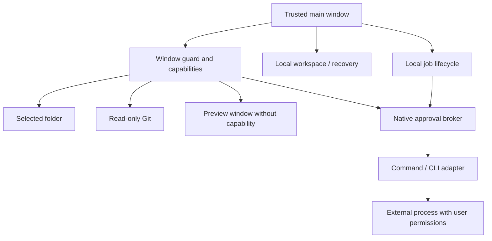

# Product architecture

This is an orientation map of the integrated MEGA-09 working tree, not a replacement for the engineering contracts in [MEGA-08](../MEGA-08.md), [MEGA-09](../MEGA-09.md) or [workspace recovery](../WORKSPACE-RECOVERY.md). The [older architecture overview](../ARCHITECTURE.md) predates the available one-shot execution broker.

| Plane | Owner | Responsibility |
|---|---|---|
| Presentation | `js/app.js`, `js/editor.js`, `js/workspace/commands.js`, `js/devcenter/ui.js` | Navigation, accessible controls, editor and review; reports capability state |
| Browser workspace | `js/workspace/model.js`, `store.js`, IndexedDB | Local projects, acknowledged persistence and conflicts |
| Disk / native authority | `src-tauri/src/local_folder.rs` and its modules | Confirmed folder sessions, relative paths, bounded search, guarded handles and explicit Save |
| Recovery | `js/local-folder.js`, local profile storage, backup v3 | Disk buffers and browser workspace backups have separate contracts |
| Git | `src-tauri/src/git_inspect.rs` | Native bounded read-only parsing; never delegates to Git hooks/filters/tools |
| Preview | `js/devcenter/preview.js`, `src-tauri/src/preview.rs` | Main mounts; separate capability-free window renders project content |
| Job persistence | `js/devcenter/jobs.js` | Attempts, queue, cancellation/restart state; no persisted approval tokens/raw output |
| Execution | `src-tauri/src/exec_broker.rs` | Exact-spec native consent, single-use approval, process tree lifetime and output |
| Provider adapters | `src-tauri/src/agent_cli.rs`, `js/devcenter/adapters.js` | Installed CLI compatibility, profile arguments and event parsing; not model ownership |
| Optional cloud / AI | Auth/AI modules, server and Convex | Separate identity/provider contracts; not automatic source synchronization |

The Rust approval broker owns execution authority. A renderer state or job checkbox cannot mint native consent. Job Objects supervise process lifetime; external processes still run with user permissions. Provider calls, later tool actions and provider billing are outside any claim of a Melly OS sandbox.

Browser/PWA has no native execution broker. The SHOWCASE-01 browser harness supplied a MOCK bridge only inside a fresh capture context. The SHOWCASE-02 native harness drove the real app through a loopback DevTools port for one QA session. Neither is part of the shipped runtime. See [media provenance](../showcase/MEDIA-SOURCES.md).
